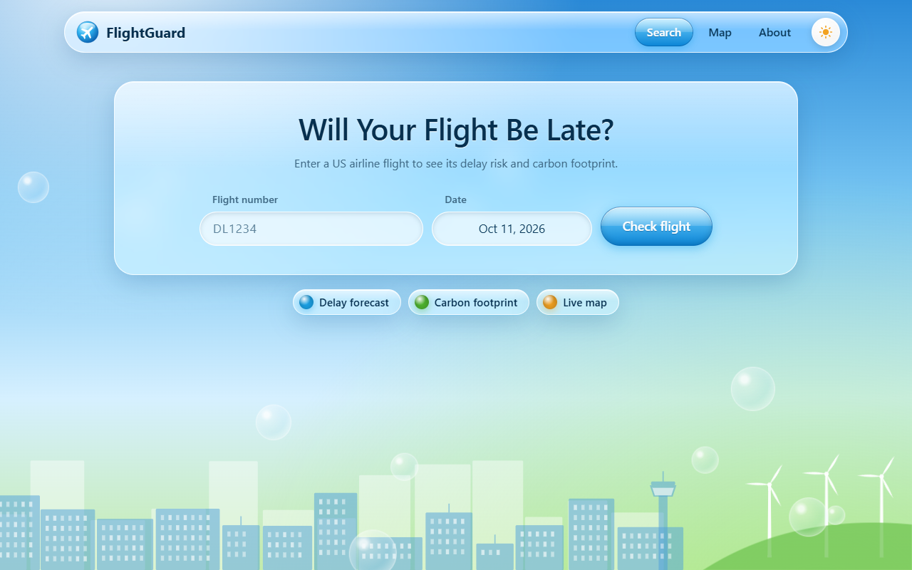
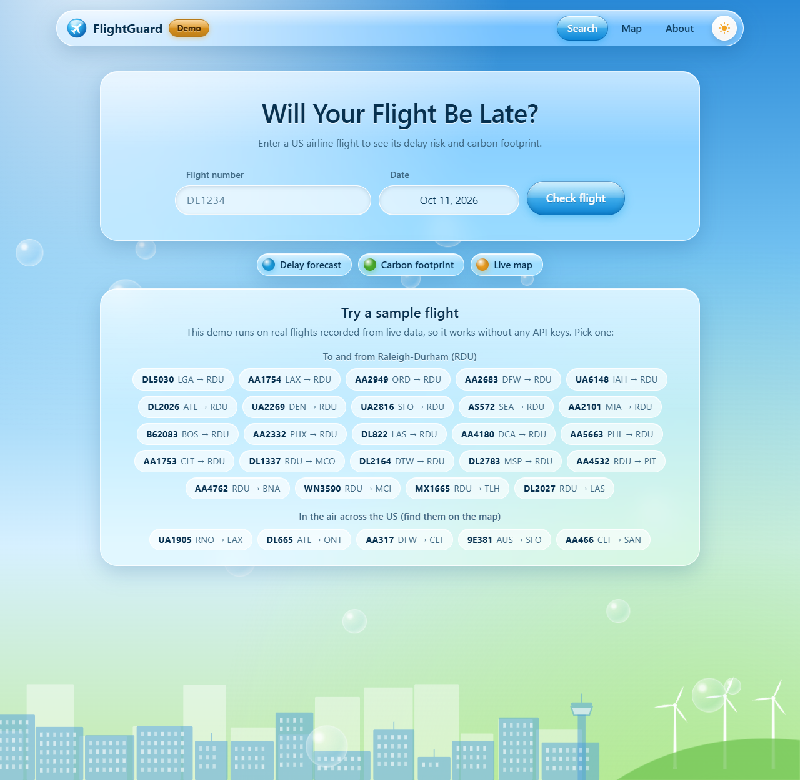
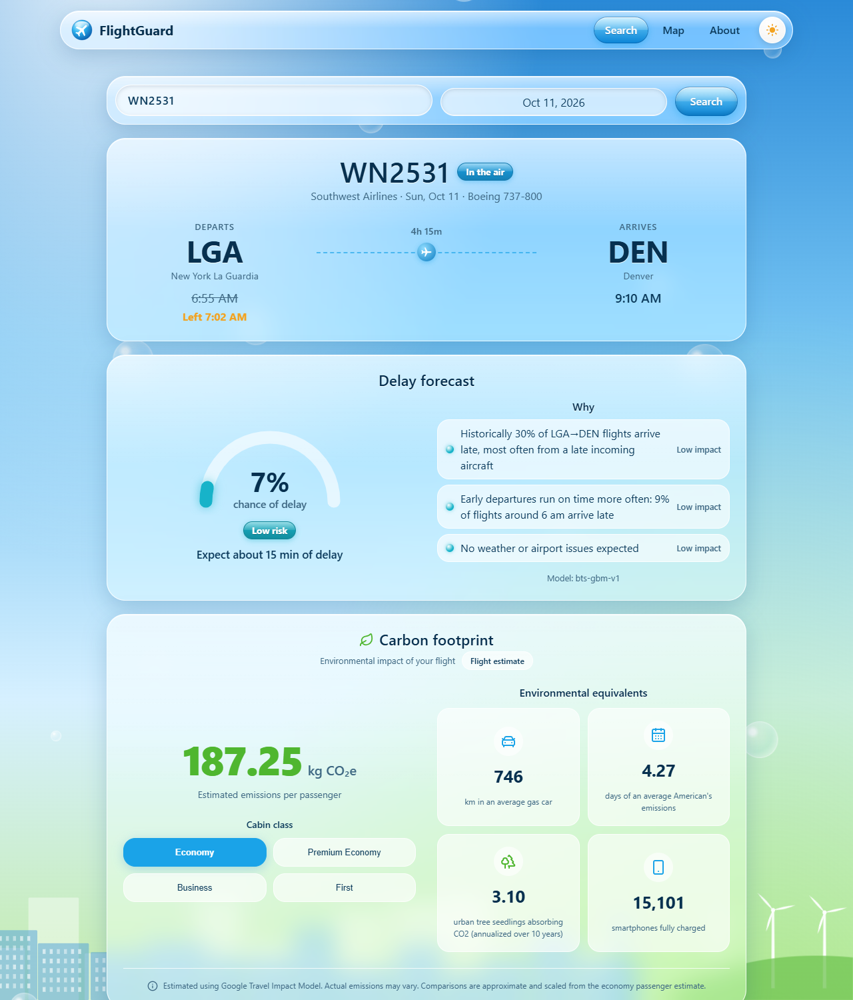
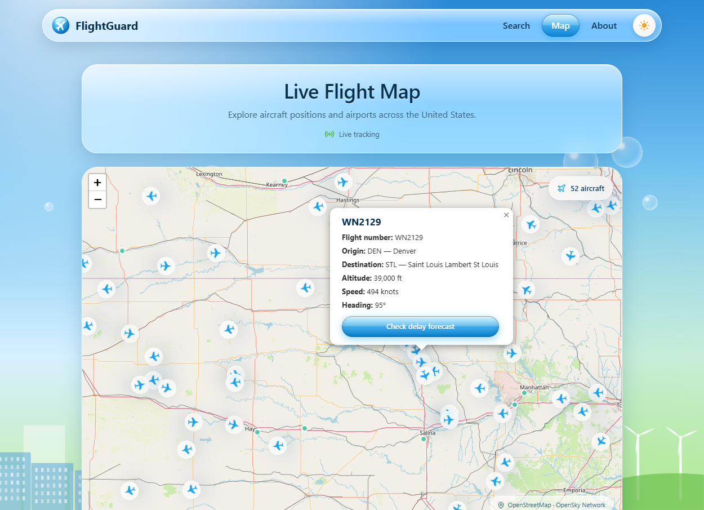
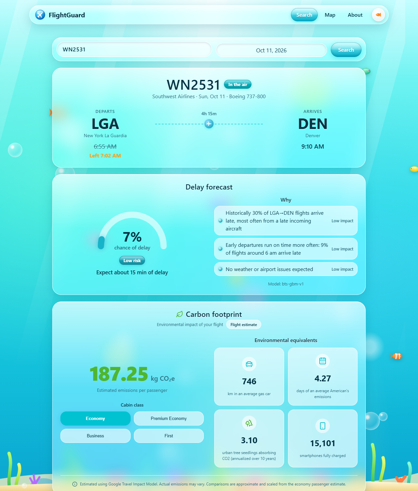
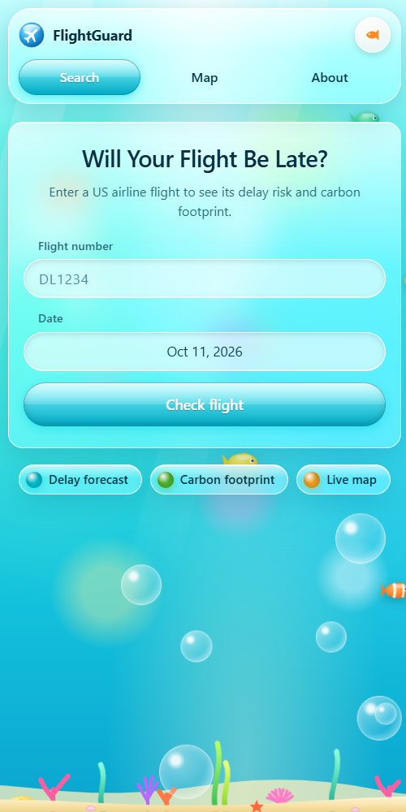

# FlightGuard

**Will your flight be late?** FlightGuard forecasts delays for US airline flights and shows the carbon footprint of your seat, wrapped in a glossy, early-2000s *Frutiger Aero* look.



---

## Try the demo

> **The hosted demo runs on recorded sample data.** Every flight, forecast, emissions figure and map plane in it is a real API response captured earlier. That lets it run as a plain static site, with no backend and no API keys.

**What the demo includes:**
- **29 real flights:** one from each major US city into Raleigh-Durham (RDU), a few RDU departures, and several flights that were in the air across the country. The search page lists them all. Pick any date, and the flights follow it.
- **The live map,** with about 1,500 recorded planes that glide along their headings, all 873 airports, and popups for the planes that are part of the demo.

**To search any flight with live data,** run FlightGuard yourself with your own free API keys (see [Run it with live data](#run-it-with-live-data)).



---

## What it does

### Flight search and delay forecast
Enter a flight number (like `DL1234` or `WN 2531`) and a date. FlightGuard shows:

- **The flight:** route, airport-local departure and arrival times, duration, aircraft, and live status (scheduled, delayed, in the air, landed or cancelled). When the airline posts a new time, the original is struck through and the update is highlighted.
- **A delay forecast:** the chance the flight arrives 15+ minutes late, a low/medium/high risk level, and the expected minutes of delay.
- **The reasons behind it:** plain-language explanations ranked by impact, for example *"Historically 30% of LGA→DEN flights arrive late, most often from a late incoming aircraft"* or *"Thunderstorms forecast at ATL around arrival"*.

The forecast comes from a **gradient-boosting model trained on US Department of Transportation (BTS) on-time records**, covering five months of flights, with a test AUC of 0.70 on a held-out month. Live signals adjust it: **weather forecasts** at both airports (Open-Meteo) and **FAA airport status** (ground stops and delay programs). If the model file is missing, a transparent rule-based score takes over.



### Carbon footprint
Each result includes the flight's **CO₂e per passenger** for economy, premium economy, business and first class.

- **Source:** estimates come from the **Google Travel Impact Model**. When Google has no data for a flight, they fall back to a typical-route estimate, then to a distance-based estimate. The card always says which kind it is.
- **Equivalents:** to make the number tangible, it's translated into four everyday comparisons:
  - km driven in an average gas car
  - days of an average American's emissions
  - urban tree seedlings needed to absorb it
  - smartphones fully charged

### Live flight map
- **Live aircraft** across the US from the OpenSky Network, refreshed every 15 seconds.
- **Plane popups:** the flight number, origin and destination, altitude, speed and heading, plus a **"Check delay forecast"** button that opens that flight's results page.
- **Airports:** 873 large and medium US airports. Clicking one shows its current weather, FAA status and delay risk.



### Three Frutiger Aero themes
Glass panels, glossy gel buttons, bubbles and nature-meets-technology scenery throughout. The sun/moon/fish button in the header cycles between:

| Day | Night | Aquarium |
|---|---|---|
| Sunny sky over a city skyline with an airport control tower and spinning wind turbines | Aurora night sky with stars, a full moon, lit windows and a blinking tower beacon | Bright turquoise water with light rays, tropical fish and a colorful coral reef |

<table>
  <tr>
    <td></td>
    <td></td>
  </tr>
</table>

Add `?theme=light`, `?theme=dark` or `?theme=aquarium` to any URL to open it in that theme. The choice is remembered.

### Works on phones
The layout adapts down to phone width, with a two-row header, full-width controls, and sections that stack into a single column.



---

## How it works

```
 Browser (React + Vite)                     FastAPI backend                         Data sources
 ──────────────────────                     ───────────────                         ────────────
 Search ─► /flight/:number/:date ──► GET /api/flights/lookup ──► flight lookup ──► AeroDataBox (schedules, status)
                                                                 ├─ delay model ──► BTS-trained model + Open-Meteo + FAA NAS
                                                                 └─ emissions ────► Google Travel Impact Model
 Map ──────────────────────────────► GET /api/flights/live ───────────────────────► OpenSky Network
                                     GET /api/airports, /api/airports/{iata}
```

- **Frontend** (`frontend/`): React 19, TypeScript, Vite, React Router and Leaflet. The design system is plain CSS with shared tokens and components in `src/components/aero/`. In development, Vite proxies `/api` to the backend.
- **Backend** (`backend/`): Python and FastAPI, with httpx for upstream APIs, in-memory caching to stay within API quotas, and scikit-learn for the delay model. Every API call has a clear error path, so the UI can show a friendly message instead of breaking.

| Data | Used for |
|---|---|
| [AeroDataBox](https://aerodatabox.com/) | Flight schedules, live status, flight numbers for map planes |
| [BTS On-Time Performance](https://www.transtats.bts.gov/) | Training data for the delay model |
| [Open-Meteo](https://open-meteo.com/) | Weather forecasts at origin and destination |
| [FAA NAS Status](https://nasstatus.faa.gov/) | Ground stops, ground delay programs and other airport events |
| [Google Travel Impact Model](https://developers.google.com/travel/impact-model) | Per-passenger flight emissions |
| [EPA equivalencies](https://www.epa.gov/energy/greenhouse-gas-equivalencies-calculator) | Car, tree and smartphone comparisons |
| [OpenSky Network](https://opensky-network.org/) | Live aircraft positions |
| [OpenStreetMap](https://www.openstreetmap.org/) | Map tiles |
| [OurAirports](https://ourairports.com/) | US airport list |

---

## Running it yourself

**You'll need:** Node.js 22.22 or newer. For live data you also need Python 3.14 and [uv](https://docs.astral.sh/uv/).

### Demo mode (no keys, no backend)
```bash
cd frontend
npm install
npm run dev:demo
```
Open http://localhost:5173. This is exactly what the hosted demo runs.

### Run it with live data
This lets you search any US airline flight with live status, forecasts and emissions. Every service has a free tier.

**1. Get your API keys.** `backend/.env.example` walks through each one step by step: where to sign up, which button to press, and what still works without it.

| Variable | Needed for | Without it |
|---|---|---|
| `AERODATABOX_API_KEY` | Flight search, and flight numbers on map planes | Searches say live data isn't connected |
| `GOOGLE_TIM_API_KEY` | Carbon footprint from Google's model | Falls back to a rough distance-based estimate |
| `OPENSKY_CLIENT_ID`, `OPENSKY_CLIENT_SECRET` | Live map planes | Works anonymously, with a much lower daily limit |
| `OPEN_METEO_BASE_URL`, `FAA_NAS_URL` | Weather and airport status | Preset; no keys needed |
| `DEMO_MODE` | Set to `false` once your keys are in | `true` serves one recorded sample flight (`DL1234` on 2026-10-11) |

**2. Start the backend.**
```bash
cd backend
cp .env.example .env      # then paste your keys into .env
uv sync
uv run fastapi dev app/main.py
```
The API runs at http://127.0.0.1:8000, with interactive docs at `/docs`. Your keys stay in `backend/.env`, which is gitignored. The browser never sees them.

**3. Start the frontend.**
```bash
cd frontend
npm install
cp .env.example .env.local   # VITE_USE_MOCKS=false means use the backend
npm run dev
```
Open http://localhost:5173.

In demo mode, the flight numbers `ZZ1`, `ZZ2`, `ZZ404`, `ZZ502` and `ZZ503` preview the empty, delayed and error states, which is handy while developing.

### Hosting the demo on Vercel
1. Import the repo in Vercel and set the **Root Directory** to `frontend`.
2. Deploy. `frontend/vercel.json` already sets the demo build (`npm run build:demo`), the `dist` output folder, and the page routing rule.

No environment variables or keys are needed, because the demo never calls a backend. Set the project's Node.js version to 22.x or newer.

### Refreshing the demo data
With live keys in `backend/.env`, this records a fresh set of flights, map planes and airport status into `frontend/src/mocks/demo/`:
```bash
cd backend
uv run python scripts/record_demo_data.py
```
It makes about 30–40 AeroDataBox calls, so it uses part of your monthly quota.

### Retraining the delay model (optional)
A trained model is already included in `backend/app/data/`. To retrain it, download monthly "Reporting Carrier On-Time Performance" zips from BTS into `backend/ml/data/`, then run:
```bash
cd backend
uv run python ml/train.py
```

### Checks
```bash
cd frontend && npm run lint && npm run build
cd backend && uv run python -m unittest discover -s tests
```

---

## Project structure

```
backend/
  app/
    api/        # FastAPI routes (lookup, predict, eco, live map, airports)
    clients/    # thin wrappers for AeroDataBox, Google TIM, Open-Meteo, FAA, OpenSky
    services/   # flight lookup, delay predictor, emissions, caching
    models/     # Pydantic response schemas
    data/       # trained model, airport list, demo fixtures, eco constants
  ml/train.py   # delay model training
  scripts/record_demo_data.py   # records the hosted demo's sample data
frontend/
  src/
    pages/       # Search, Results, Map, About
    components/  # aero (design system), results, eco, map, search, demo
    api/         # typed API client; demoData.ts serves recorded data in demo mode
    mocks/demo/  # recorded sample data for the demo
    types/       # TypeScript mirror of the API contract
  vercel.json    # hosted demo build settings
docs/screenshots/
```

Contributors (human or AI) should read [`AGENTS.md`](AGENTS.md) first. It covers the API contract, file ownership, the theme guide and the team's working rules.

---

## Notes

- Delay forecasts and emissions are **estimates** to help you plan. They aren't guarantees, and FlightGuard isn't affiliated with any airline.
- In the hosted demo, flights and map planes are a recorded snapshot. Their statuses (landed, in the air and so on) reflect when the data was captured, not the current time.
- FlightGuard currently covers **US passenger airlines** and flights to or from US airports.
